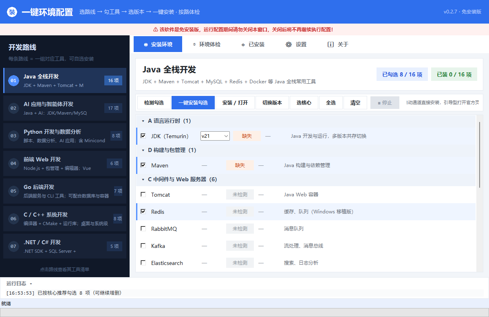
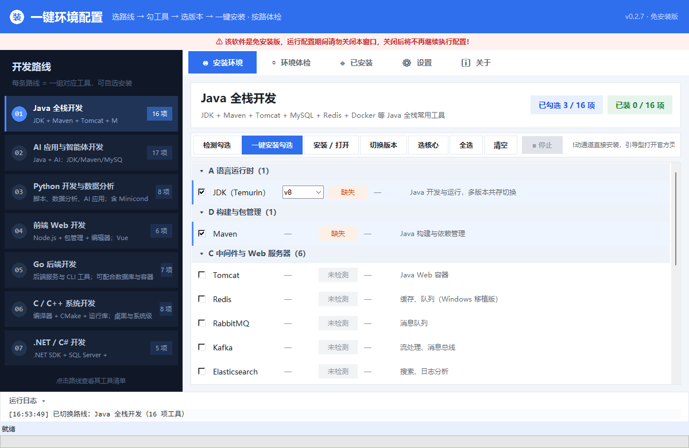
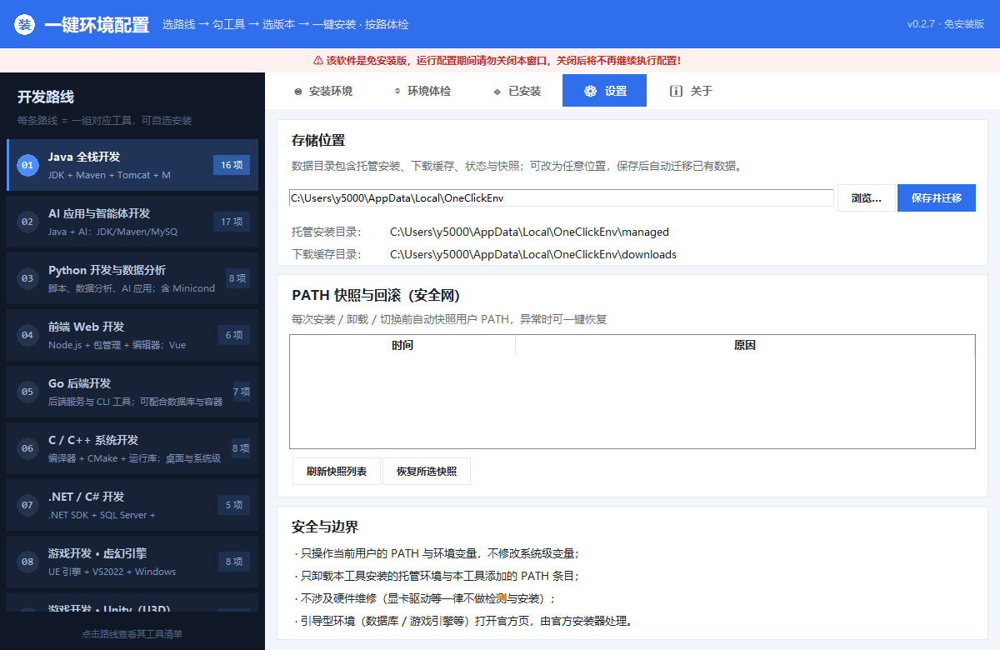
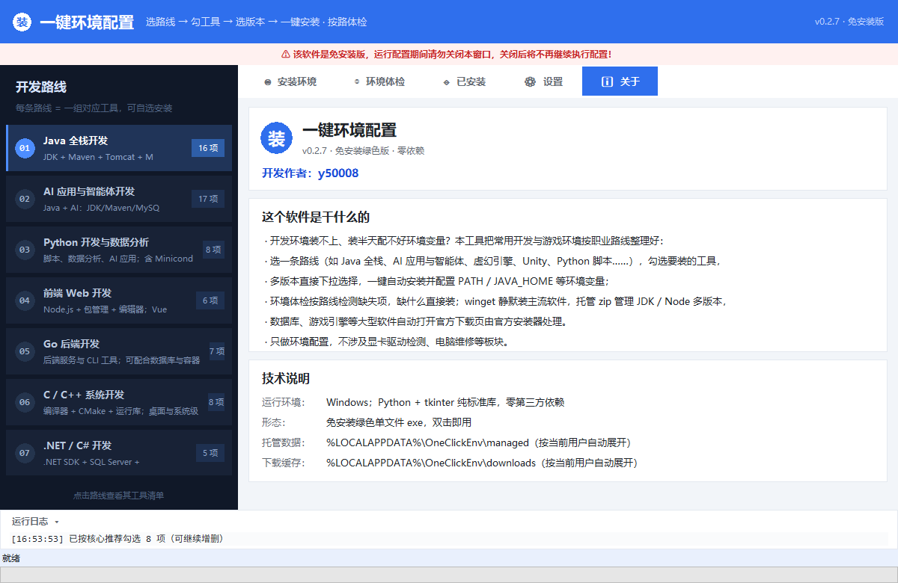

# 一键环境配置（OneClick Env Config）

一个 Windows 下的一键环境安装与配置工具。面向开发者和游戏玩家：选一条职业路线，勾上要装的工具和版本，点一下，剩下的下载、安装、配环境变量我来做。

[](#)
[](#)
[](#)
[](#)

---

## 这软件是干嘛的

装开发环境最烦的不是下载，是装完之后还要自己配 PATH、配 JAVA_HOME，还要记版本。尤其换新电脑的时候，一套环境装下来半天就没了。

这软件把常见职业路线的工具整理成 14 条路线，你选一条路，勾几个工具，它负责：

- 自动下载并安装（winget 静默装 / 托管 zip 解压 / 官方 exe 静默装）
- 自动配置环境变量（PATH、JAVA_HOME、CATALINA_HOME 等）
- 检测当前路线上缺哪些环境、装没装对
- 卸载和 PATH 回滚

只做环境配置。不做显卡驱动检测，不碰电脑维修相关的东西。

## 界面





| 设置页（存储位置可改，保存后自动迁移） | 关于页（作者 / 技术说明） |
|---|---|
|  |  |

## 演示


## 主要功能

- **路线化安装**：14 条路线（AI 应用、Java、Python、前端、Go、C/C++、.NET、虚幻引擎、Unity、游戏脚本、数据库、DevOps、全栈、全部），每条路线列出对应的工具清单
- **复选框勾选 + 行内选版本**：每行是复选框，多版本工具（JDK 8/11/17/21/25、Node 16/18/20/22/24）直接在行内下拉框选，不用弹窗
- **按路体检**：只检测当前路线涉及的环境，缺了就给装
- **一键安装**：自动通道后台装好并配好环境变量；MySQL、UE、Unity 这类需要交互配置的软件，直接打开官方下载页
- **停止按钮**：安装跑起来之后，工具栏有红色停止按钮，误点了可以取消（下载中断会保留，下次续传）
- **多版本切换**：JDK / Node 可以同时装多个版本，一键切默认版本
- **卸载干净**：只删自己装的东西和自己加的 PATH 条目，不会误删你原有的
- **PATH 快照**：每次改动环境变量前自动备份，设置页可以回滚
- **存储位置可改**：设置页里可以把数据目录改到任意位置，保存后自动把旧数据搬过去
- **免安装单文件 exe**：双击就能跑，不需要先装 Python

## 支持的路线（62 项环境）

| 路线 | 包含工具（节选） | 项数 |
|---|---|---|
| AI 应用与智能体开发 | JDK、Maven、MySQL、Redis、Docker、Python、Miniconda、CUDA、Git 等 | 17 |
| Java 全栈开发 | JDK（多版本）、Maven、Tomcat、MySQL、Redis、RabbitMQ、Kafka、Elasticsearch、Nginx、Docker、Git、VS Code 等 | 16 |
| Python 开发与数据分析 | Python、Miniconda、pip/uv、MySQL、Git、VS Code 等 | 8 |
| 前端 Web 开发 | Node.js（多版本）、pnpm、Nginx、Git、VS Code 等 | 6 |
| Go 后端开发 | Go、MySQL、Redis、Docker、Git、VS Code 等 | 7 |
| C/C++ 系统开发 | MinGW、MSVC、CMake、GNU Make、VC++ 运行库、Git 等 | 8 |
| .NET / C# 开发 | .NET SDK、SQL Server、Git、VS Code 等 | 5 |
| 游戏开发 · 虚幻引擎 | UE、VS2022、Windows SDK/DirectX、Vulkan、Git、Lua 等 | 8 |
| 游戏开发 · Unity（U3D） | Unity Hub/Editor、VS2022、.NET SDK、Git 等 | 7 |
| 游戏脚本 / Mod 运行 | Python、Lua、Git、VS Code 等 | 5 |
| 数据库与缓存工程师 | MySQL、PostgreSQL、SQL Server、MongoDB、SQLite、MariaDB、Oracle XE、Redis、DBeaver 等 | 10 |
| 容器与云原生（DevOps） | Docker、WSL2、kubectl、Helm、Podman、Git 等 | 7 |
| 全栈开发（综合） | JDK + Python + Node + Go + MySQL + Redis + Docker 等 | 11 |
| 全部环境（浏览） | 全部 62 项，按需勾选 | 62 |

完整清单在 `env_catalog.json` 里，想加环境改这个文件就行。

### 安装方式是怎么分的

| 通道 | 覆盖 | 说明 |
|---|---|---|
| winget 静默 | Git、Python、Go、.NET SDK、Docker、VS Code、DBeaver、7-Zip 等 | 走系统包管理器 |
| 托管 zip | JDK（Adoptium）、Node.js、Nginx、Redis、Tomcat、Maven、FFmpeg | 解压到数据目录，自动配 PATH / JAVA_HOME / CATALINA_HOME |
| 官方 exe/msi | VC++ Redistributable 等 | 官方链接 + 静默参数 |
| 引导型 | MySQL、PostgreSQL、UE、Unity、Godot、VS2022、Vulkan、CUDA | 打开官方下载页，自己装 |

数据库和引擎这些软件装的时候要交互配置（账号、组件、协议），静默装容易出问题，所以做成打开官方页让你自己装，更稳。

## 使用

**普通用户**：从 [Releases 页面](https://github.com/y50008/oneclick-env-config/releases/latest) 下载 `oneclick-env-config.exe`（或 [直接下载 v0.2.7](https://github.com/y50008/oneclick-env-config/releases/download/v0.2.7/oneclick-env-config.exe)），双击运行。exe 里打包好了 Python 运行时，不需要本机装任何东西。选路线 → 勾工具 → 点「安装 / 打开」。

> ⚠️ 免安装版运行配置期间别关窗口，关了任务就不会继续了。软件介绍和作者在右上角「关于」里。

**源码运行**（需要 Python 3.9+）：

```bash
python main.py
```

代码只用 Python 标准库（tkinter / json / urllib / winreg / shutil），零第三方依赖。

## 构建 exe

```bash
py -m PyInstaller --noconfirm --clean "一键环境配置.spec"
# 产物在 dist/一键环境配置.exe（onefile + windowed，约 11 MB）
```

spec 里配了 `datas=[('env_catalog.json','.')]`（把路线数据打进 exe）和 `console=False`（不弹黑窗）。

## 目录结构

```
一键环境配置/
├── main.py              # 主程序（tkinter 界面 + 设置/关于页）
├── env_catalog.json     # 环境目录（62 项）+ 路线（14 条）
├── 一键环境配置.spec     # PyInstaller 打包配置
├── 启动一键环境配置.bat  # 源码版启动脚本
├── core/
│   ├── catalog.py       # 目录加载
│   ├── detect.py        # 环境检测（命令 / 注册表 / 目录 / 托管）
│   ├── install.py       # 安装 / 卸载 / 版本切换
│   ├── net.py           # 下载器（进度 / 断点续传 / 重试）
│   ├── pathman.py       # PATH 管理（快照 / 回滚 / 增删）
│   └── state.py         # 状态库 + 数据目录管理
└── dist/
    └── 一键环境配置.exe
```

## 数据存哪

数据目录默认在 `%LOCALAPPDATA%\OneClickEnv`，设置页里可以改到别处，保存后旧数据自动搬过去（位置记录在注册表 `HKCU\Software\OneClickEnv\data_root`）。

```
OneClickEnv/
├── managed/     # 托管安装（JDK/Node 这类解压式软件）
├── downloads/   # 下载缓存
├── snapshots/   # PATH 快照
└── state.json   # 已安装记录 / 设置
```

## 安全方面

- 只动当前用户的 PATH 和环境变量（`HKCU\Environment`），不碰系统级
- 改 PATH 之前自动快照，设置页能恢复
- 卸载只删自己装的目录和完全匹配的 PATH 条目
- 下载走 HTTPS，优先官方源
- winget 或系统级安装器弹 UAC 就点「是」

## 版本记录

| 版本 | 更新 |
|---|---|
| v0.1.0 | 初版，四页签平铺列表 |
| v0.2.0 | 改成路线化，13 条路线 |
| v0.2.1 | 界面重做（导航卡片 + 统计徽章），加 AI 应用路线（17 项） |
| v0.2.2 | 版本下拉框放到行内；复选框勾选 |
| v0.2.3 | 打开官方页 / 切版本直接作用于勾选的环境 |
| v0.2.4 | 去掉「无需单独安装」的提示，缺了就直接装 |
| v0.2.5 | 加停止按钮；头部红色免安装警告；加「关于」页 |
| v0.2.6 | 关于页路径改成 `%LOCALAPPDATA%` 通用写法 |
| v0.2.7 | 设置页存储位置可修改，保存后自动迁移数据 |

## 常见问题

**没装任何环境的电脑能直接双击 exe 吗？**
能。exe 内置了 Python 运行时、tkinter 库、VC++ 运行库这些，我试过只留系统目录的 PATH 下也能正常启动。

**会改我的系统变量吗？**
不会，只改当前用户的，而且改之前有快照。

**装错了能卸吗？**
托管软件能一键卸载；winget 装的走系统卸载入口。

**想加个环境 / 路线？**
改 `env_catalog.json` 就行，欢迎提 Issue 或 PR。

## 协议

MIT License，详见 `LICENSE` 文件。

## 说明

这工具会自动下载安装第三方软件、修改用户环境变量，用之前心里有数就行。它和那些第三方软件官方没有关系，安装时弹 UAC 是正常现象。安装失败或使用中造成的损失作者不担责。

---

**作者：y50008**
